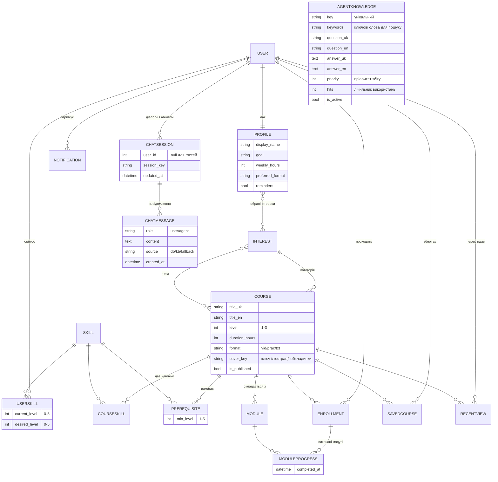

# ERD (розділ 1.2)

Діаграму можна відкрити у будь-якому Mermaid-рендері (GitHub, VS Code, mermaid.live) і додати до звіту як зображення.

> У цій же теці лежить **`docs/ERD.mwb`** — готова модель тієї ж бази для **MySQL Workbench**
> (усі 28 таблиць, звʼязки FK та ER-діаграма). Відкриється подвійним кліком або через
> Workbench → *File → Open Model*.
> У VS Code модель не відкривається (це бінарний формат Workbench) — там користуйтесь
> Mermaid-блоком нижче: розгорніть попередній перегляд Markdown
> (розширення *Markdown Preview Mermaid Support*; підказки є у `.vscode/extensions.json`).

## Обмеження цілісності (міграція 0002)

| Таблиця | Обмеження / індекс |
|---|---|
| `course` | `UNIQUE` немає; `CHECK level IN (1,2,3)`, `CHECK duration_hours > 0`; індекси `(is_published, level)`, `(category, format)` |
| `courseskill` | `UNIQUE (course, skill)`; індекс `(skill, order)` |
| `prerequisite` | `UNIQUE (course, skill)`, `CHECK min_level >= 1` |
| `module` | `UNIQUE (course, order)` |
| `profile` | `UNIQUE (user)`, `CHECK weekly_hours BETWEEN 1 AND 30` |
| `userskill` | `UNIQUE (user, skill)`, `CHECK current_level <= 5`, `CHECK desired_level <= 5`; індекс `(user, skill)` |
| `enrollment` | `UNIQUE (user, course)`; індекс `(user, started_at)` |
| `moduleprogress` | `UNIQUE (enrollment, module)`; індекс на `completed_at` |
| `savedcourse` / `recentview` | `UNIQUE (user, course)`; `recentview` — індекс `(user, -viewed_at)` |
| `notification` | індекс `(user, is_read)` |
| `agentknowledge` | `UNIQUE (key)`; індекс `(is_active, -priority)` |
| `chatsession` | індекс `(user, -updated_at)`, `session_key` індексовано |
| `chatmessage` | індекс `(session, created_at)`; `created_at` індексовано |

Точний SQL, який Django генерує для цих таблиць, лежить у `docs/schema.sql`
(отримано командами `python manage.py sqlmigrate core 0001` та `python manage.py sqlmigrate core 0002`).
