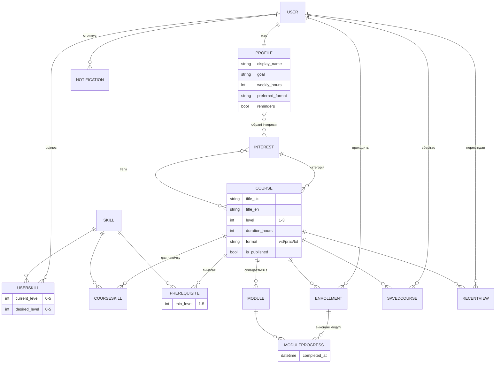

# ERD (розділ 1.2)

Діаграму можна відкрити у будь-якому Mermaid-рендері (GitHub, VS Code, mermaid.live) і додати до звіту як зображення.

Точний SQL, який Django генерує для цих таблиць, лежить у `docs/schema.sql`
(отримано командою `python manage.py sqlmigrate core 0001`).
